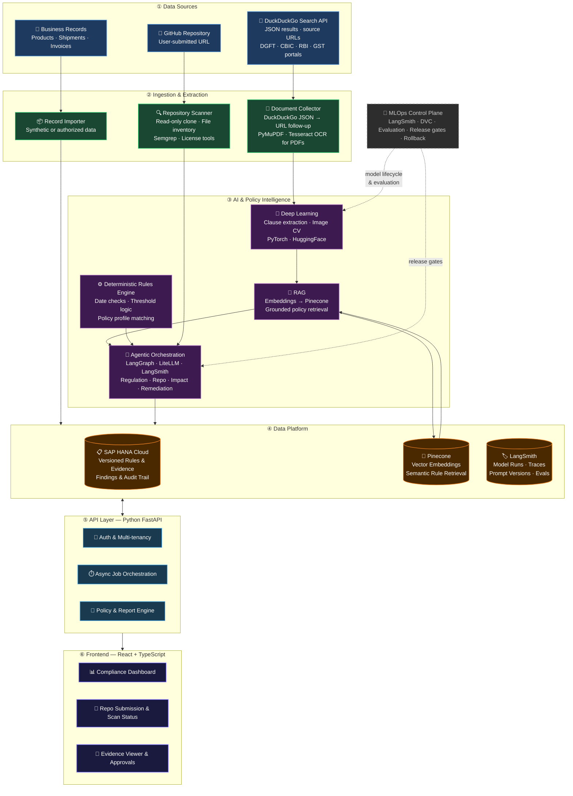
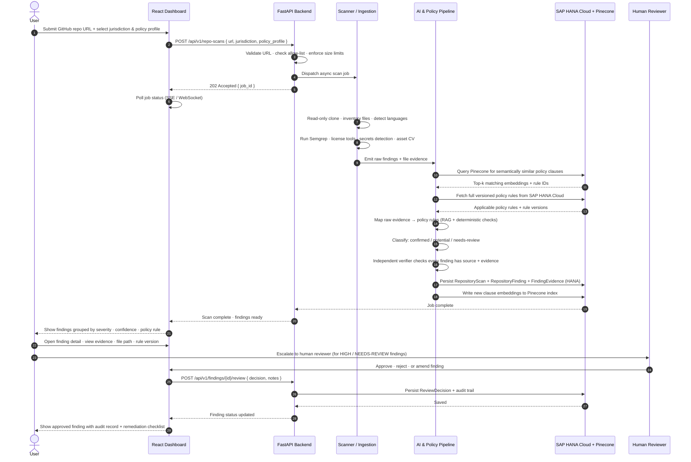

# Compliance Shadow

<div align="center">


**AI-Powered Regulatory and Source-Code Compliance Intelligence**

_Connecting regulatory changes to business records and software repositories — with evidence, traceability, and human oversight_

[Overview](#1-executive-summary) · [Architecture](#5-system-architecture) · [Features](#3-main-capabilities) · [Tech Stack](#6-technology-stack) · [Agents](#7-agent-design-and-safety-boundaries) · [MLOps](#8-deep-learning-and-mlops) · [Roadmap](#12-mvp-scope-and-implementation-phases)

</div>

---

## Table of Contents

1. [Executive Summary](#1-executive-summary)
2. [Problem Statement](#2-problem-statement)
3. [Main Capabilities](#3-main-capabilities)
4. [Example User Journeys](#4-example-user-journeys)
5. [System Architecture](#5-system-architecture)
6. [Technology Stack](#6-technology-stack)
7. [Agent Design and Safety Boundaries](#7-agent-design-and-safety-boundaries)
8. [Deep Learning and MLOps](#8-deep-learning-and-mlops)
9. [SAP HANA Data Model](#9-sap-hana-data-model)
10. [Security and Responsible Operation](#10-security-and-responsible-operation)
11. [Research Contribution](#11-research-gap-and-defensible-contribution)
12. [MVP Scope and Implementation Phases](#12-mvp-scope-and-implementation-phases)
13. [Evaluation Plan](#13-evaluation-plan)
14. [What This Project Does Not Promise](#14-what-this-project-does-not-promise)
15. [Repository Structure](#15-repository-structure)
16. [Getting Started](#16-getting-started)
17. [Contributing](#17-contributing)

---

## Project Info

| Field | Details |
|---|---|
| **Project type** | Pure-software platform |
| **Primary domains** | Regulatory intelligence · Software compliance · AI-assisted code review |
| **Target users** | Indian MSME exporters · Software teams · Compliance teams · Organizations across jurisdictions |
| **Frontend** | React + TypeScript + Vite + Tailwind CSS |
| **Backend** | Python + FastAPI + Pydantic |
| **Primary database** | SAP HANA Cloud (structured) · Pinecone (vector) |
| **AI stack** | Agentic AI · Deep Learning · RAG · LangGraph · LangSmith |
| **MLOps** | LangSmith · DVC · automated evaluation · controlled model deployment |

---

## 1. Executive Summary

**Compliance Shadow** is a platform that helps organizations answer two related questions:

1. **Business and regulatory compliance** — What has changed in relevant regulations, and which products, shipments, documents, or operations might be affected?
2. **Software and digital-product compliance** — If we provide a GitHub repository URL, what risks or policy conflicts may exist in the source code, dependencies, configuration, documentation, and website assets?

The platform ingests official regulatory publications, extracts and versions relevant obligations, and maps those obligations to business records. Separately, it inspects a supplied source-code repository and assesses it against selected policies, licensing requirements, security rules, jurisdictional requirements, and organizational guidelines.

> **Example:** An organization submits a repository and selects a target jurisdiction. Compliance Shadow could identify that the repository contains a country-flag image, find its file path and usage, identify the relevant policy question, and explain what needs verification — **without automatically claiming** the flag is illegal, since rules depend on the country, asset, context, and applicable law.

The system is **decision support, not a substitute for legal advice** or a guarantee of compliance. Every finding includes evidence, confidence level, rule version, and whether the issue is confirmed, potential, or requires expert review.

---

## 2. Problem Statement

Regulatory requirements change through circulars, notifications, amendments, standards, and official guidance. Organizations often struggle to connect a change to the actual transactions, documents, products, or software they operate.

Software itself can also introduce compliance risks:

- Assets used without a clear license
- Third-party components with incompatible licenses
- Exposed secrets or credentials
- Personal data collected without appropriate notices
- Imagery and branding conflicting with a jurisdiction's laws or organizational policies

The core problem is establishing:

1. What changed compared with the previous applicable version?
2. Which obligation, product, activity, or effective date is affected?
3. Which business records or code artifacts may be impacted?
4. What evidence supports the interpretation?
5. What action should a responsible person review?

---

## 3. Main Capabilities

### A. Regulatory Change Intelligence

- Monitor selected official sources: DGFT, CBIC, RBI, GST-related sources, and other relevant authorities
- **Collect regulatory data via the [DuckDuckGo Search API](https://duckduckgo.com/)** — returns clean structured JSON results without HTML scraping or bot-detection friction
- Parse returned JSON results to extract document titles, source URLs, publication dates, and snippet text
- Follow discovered URLs to retrieve full documents (PDF or HTML) only where DuckDuckGo JSON does not surface sufficient detail
- Compare a new publication with prior versions and draft a structured description of the change
- Store the original source, extracted rule, version, publication date, effective date, and evidence references
- Mark ambiguous or conflicting interpretations for human review

### B. Business Impact Analysis

- Import synthetic or authorized business records (products, export shipments, certificates, invoices, document checklists)
- Match applicable rules to business records using deterministic conditions and AI-assisted retrieval
- Identify potentially affected transactions and missing evidence
- Generate a risk explanation and proposed remediation checklist
- Keep risk scores explainable — show contributing factors rather than unexplained numbers

### C. GitHub Repository and Source-Code Compliance Analysis

A user submits a GitHub repository URL and selects a target country or jurisdiction, application type, and organization policy profile.

#### 1. Dependency and Open-Source Licensing
- Read package manifests and lockfiles
- Identify third-party packages and declared licenses
- Flag missing license information or potentially incompatible license combinations
- Report dependency names, versions, manifest paths, and supporting evidence

#### 2. Secrets and Configuration
- Detect likely API keys, credentials, tokens, private keys, and unsafe configuration patterns
- Redact secret values from the UI and reports
- Recommend rotation when a real secret may have been exposed
- Never store or reproduce discovered credentials unnecessarily

#### 3. Privacy and Personal-Data Handling
- Detect likely collection or processing of personal data (email addresses, location, identifiers, analytics events)
- Find relevant code paths, forms, API calls, telemetry events, and privacy-policy references
- Compare findings with a selected privacy checklist or jurisdiction profile
- Treat static analysis as a signal — it cannot prove runtime behavior or determine legal applicability by itself

#### 4. Country-Specific or Organization-Specific Policy Checks
- Evaluate configured requirements for a target jurisdiction, industry, or organization
- Detect relevant code, configuration, text, and assets
- Connect each finding to a versioned policy entry and an evidence location
- Allow policies to be added, reviewed, approved, and updated separately from model prompts

#### 5. Brand, Flag, and Visual-Asset Review
- Inventory images, SVG files, icons, logos, and other bundled assets
- Use computer vision to identify likely country flags, official emblems, and recognizable brand marks
- Record file path, image hash, probable asset type, and where the asset is referenced
- Report possible concerns for review — **not** automatically labelling an image unlawful
- Explain that flag and emblem rules vary by jurisdiction and context

#### 6. Website and Application Behavior Indicators
- Inspect routes, forms, scripts, tracking integrations, API calls, cookie-related code, and public-facing notices
- Optionally run a controlled test deployment in a sandbox to observe behavior
- Distinguish static-code evidence from runtime observations

#### 7. Remediation Assistance
- Explain each finding in plain language
- Link the finding to file path, line range, relevant policy version, and supporting evidence
- Draft a patch or pull-request suggestion for developer review
- **Never** automatically push changes to a repository without explicit authorization

### D. Unified Compliance Dashboard

- New regulatory changes and publication timeline
- Business records potentially affected by those changes
- Repository scan status and progress
- Findings grouped by severity and confidence
- Evidence, source citations, and rule version
- Suggested fixes and approval status
- Model version and evaluation metadata for AI-generated findings

---

## 4. Example User Journeys

### Scenario 1 — Regulatory Change Affects an Exporter

1. Ingestion service detects a new official circular
2. Document pipeline extracts content, compares with prior version
3. Regulation agent drafts a structured change with exact source references
4. Policy/rules validation checks required fields, dates, and contradictions
5. New rule stored as a proposed version in SAP HANA Cloud; embeddings written to Pinecone
6. After validation or human approval, impact agent checks synthetic shipment records
7. User sees: affected records · evidence · uncertainty · recommended actions

### Scenario 2 — Team Checks a GitHub Website Repository

1. User enters a repository URL, selects jurisdiction and policy profile
2. Backend validates URL, access permissions, repository size, allowed file types
3. Scanner reads source files, manifests, configuration, documentation, and assets (no code execution by default)
4. DL and static-analysis components identify potential issues: likely national-flag asset, undeclared image license, personal-data collection flow, or risky dependency
5. Policy agent retrieves applicable checklist, checks whether evidence supports a finding
6. Result explains: what was detected · where it appears · why it may matter · what remains uncertain · what a developer can do next
7. User can request a patch proposal, but must approve any repository modification

**Example finding output:**

> `public/images/flag.svg` appears to depict a national flag and is referenced on the homepage. The asset's origin and license are not documented. The selected jurisdiction profile contains a review requirement for official symbols. **Confirm the asset's source, intended context, and applicable rules before release.**
>
> _This is a review finding, not a declaration that the website violates the law._

---

## 5. System Architecture

The platform is organized into **six layers**, each with a clearly scoped responsibility. Data flows in one direction — from ingestion through intelligence to the user — with SAP HANA Cloud holding all structured/relational records and **Pinecone** storing all vector embeddings for semantic retrieval.



---

### End-to-End Request Flow

This diagram shows exactly how a user request travels through the system — from submission to a reviewed compliance finding.



---

### Layer Responsibilities at a Glance

| Layer | What it does | What it does NOT do |
|---|---|---|
| **Data Sources** | DuckDuckGo JSON search · GitHub repos · business records | Execute repo code · accept arbitrary URLs |
| **Ingestion** | DuckDuckGo API → URL follow-up → PDF/HTML parse · file inventory | Store raw secrets · scrape without permission |
| **AI & Policy** | Map evidence to versioned rules · classify findings · draft remediation | Make legal determinations · approve its own output |
| **SAP HANA Cloud** | Structured records — versioned rules · findings · audit trail | Store raw vector embeddings |
| **Pinecone** | Vector embeddings — fast semantic similarity search for policy clauses | Store structured/relational records |
| **FastAPI** | Auth · async job management · policy orchestration · report export | Push to user repos · submit government forms |
| **React Dashboard** | Display evidence · drive human review · show audit history | Auto-approve findings · bypass reviewer workflow |
| **LangSmith / MLOps** | LLM tracing · prompt versioning · model run tracking · release gates · rollback | Block the synchronous request path |

---

## 6. Technology Stack

| Layer | Technology | Responsibility |
|---|---|---|
| **Frontend** | React · TypeScript · Vite · Tailwind CSS | Dashboard · repository submission · evidence viewer · policy selection · scan progress · approvals |
| **Backend API** | Python · FastAPI · Pydantic | REST APIs · validation · job management · policy orchestration · report generation |
| **Structured database** | SAP HANA Cloud | Versioned rules · findings · evidence metadata · business records · audit trail |
| **Vector database** | [Pinecone](https://www.pinecone.io/) | Store and query clause/policy embeddings for semantic RAG retrieval — accessed via Pinecone API key |
| **Data ingestion** | [DuckDuckGo Search API](https://duckduckgo.com/) | Fetch regulatory source links in clean JSON format; follow URLs to retrieve full documents (PDF/HTML) where needed |
| **Agentic AI** | LangGraph · LangSmith | Multi-step investigation · tool routing · evidence gathering · LLM call tracing · prompt versioning |
| **LLM access** | LiteLLM gateway or program-provided model API | Route supported models · manage model calls · keep API keys in environment variables or a secret manager |
| **Deep learning** | PyTorch · Hugging Face Transformers | Document-layout understanding · clause/entity extraction · image/asset recognition |
| **RAG** | Embeddings + Pinecone similarity search | Retrieve the most semantically relevant policy clauses to ground each finding |
| **ML experiment tracking** | [LangSmith](https://www.langchain.com/langsmith) | Trace LLM calls · version prompts · track model runs · run evaluations · manage release gates |
| **Dataset versioning** | DVC | Version datasets and model artifacts alongside Git |
| **Static code analysis** | Semgrep · language-specific linters · dependency/license tools | Deterministic detection of code patterns and dependency metadata |
| **Document extraction** | PyMuPDF · Tesseract OCR (when needed) | Extract PDF text and handle scanned documents |
| **CI/CD** | GitHub Actions · Docker | Test and package services · run regression tests · build reproducible containers |
| **Optional SAP UI** | SAP Fiori / UI5 | Use alongside React if the project sponsor requires SAP-native UI |
| **Optional SAP integration** | CAP or ABAP Cloud / RAP | Add if SAP application integration is a project requirement |

> **Design decisions:**
> - **Pinecone** is used exclusively for vector embeddings and similarity search. All structured, relational, and audit records remain in SAP HANA Cloud.
> - **DuckDuckGo Search API** is used for regulatory discovery — returning structured JSON so the backend never needs to parse raw HTML or handle bot-detection.
> - **LangSmith** replaces MLflow for LLM-specific tracing, prompt versioning, and model evaluation. DVC handles dataset and non-LLM artifact versioning.

---

## 7. Agent Design and Safety Boundaries

Use specialized agents with restricted tools. Agents must **not** be given unrestricted shell, network, or repository write access.

| Agent | Input | Responsibility | Boundary |
|---|---|---|---|
| **Regulation Agent** | New document, previous version, extracted clauses | Summarize publication · extract candidate obligations and effective dates · produce structured change proposal with citations | Cannot mark a rule legally authoritative without validation |
| **Repository Analysis Agent** | Repository URL, selected jurisdiction and policy profile | Select appropriate scanners · collect scan evidence · ask follow-up tools for clarification | Cannot execute untrusted repository code · cannot write to the user's GitHub repository |
| **Policy Applicability Agent** | Jurisdiction, application context, policy profile, scan evidence | Select relevant rules · distinguish "detected pattern" from "confirmed violation" · flag missing facts | Cannot make legal determinations without explicit human review |
| **Impact Agent** | Validated regulatory changes, business profile and records | Map validated changes to products, shipments, code components · use deterministic rules for dates, thresholds | Reports evidence behind the result |
| **Remediation Agent** | Reviewed finding and evidence | Draft a checklist, code patch, or pull-request description · include tests when possible | Requires human approval before any consequential external action |
| **Independent Verifier** | All findings | Check that every finding has a source · evidence location · rule version · confidence label · run regression cases | Prevents LLM-generated explanations from being treated as proof |

### Agent Execution Controls

- Every material claim must point to a source document and clause/page
- Agents receive only the tools and data required for their task
- Use structured output schemas and validation
- Do not allow an agent to approve its own legal interpretation
- External submissions, record modifications, and consequential actions require explicit human approval
- Log prompts, model identifiers, tool calls, retrieved evidence, and reviewer decisions

---

## 8. Deep Learning and MLOps

### Candidate Deep-Learning Tasks

| Task | Approach |
|---|---|
| Extract structured fields from complex regulatory documents | Transformer-based document understanding |
| Recognize document clauses and match semantically similar versions | Semantic embedding → stored in Pinecone for retrieval |
| Identify likely flag, emblem, or logo assets from repository images | Computer vision classification |
| Rank potentially relevant code or text snippets for policy review | Text relevance scoring |

> Do not use an image classifier alone to decide whether an asset is legally allowed. Legal applicability depends on jurisdiction and context, which require policy rules and often human review.

### MLOps Stack — LangSmith + DVC

| Tool | Role |
|---|---|
| **[LangSmith](https://www.langchain.com/langsmith)** | Trace every LLM call end-to-end · version prompts · compare model outputs across runs · run automated evaluations · set release gates |
| **DVC** | Version datasets and non-LLM model artifacts (PyTorch checkpoints, OCR model weights) alongside the Git repo |

### MLOps Lifecycle Steps

1. **Dataset curation** — Collect labelled documents via DuckDuckGo API + manual review; version with DVC
2. **Prompt versioning** — Store and version all LLM prompts in LangSmith; never hard-code prompts in source
3. **Training** — Fine-tune only if labelled data justifies it; otherwise use a pretrained model and benchmark it
4. **Tracing** — Every agent LLM call is automatically traced in LangSmith with inputs, outputs, latency, and token cost
5. **Evaluation** — Run LangSmith evaluations on a fixed test set; measure precision, recall, and unsupported-claim rate
6. **Release gates** — Promote a prompt or model version only if it meets agreed thresholds in LangSmith
7. **Monitoring** — Use LangSmith dashboards to track model confidence drift, false-positive trends, and failure patterns
8. **Rollback** — Revert to the previous prompt or model version in LangSmith if a new version degrades performance

### Suggested Evaluation Metrics

| Component | Metrics | Tracked in |
|---|---|---|
| PDF extraction | Character/word error rate; table and field extraction accuracy | DVC + LangSmith |
| Clause extraction | Precision, recall, F1 | LangSmith evaluations |
| Effective-date extraction | Exact-match accuracy | LangSmith evaluations |
| Change detection | Precision, recall, F1 for additions/removals/amendments | LangSmith evaluations |
| Impact assessment | Affected-record precision/recall; false-positive rate | LangSmith evaluations |
| Grounded generation | Citation correctness, evidence coverage, unsupported-claim rate | LangSmith tracing |
| Pinecone retrieval | Top-k recall on policy clause retrieval test set | Custom eval scripts |
| System | Processing time, failure rate, reproducibility | LangSmith + CI metrics |

---

## 9. Data Model (SAP HANA Cloud + Pinecone)

### SAP HANA Cloud — Structured Records

| Entity | Key Fields | Purpose |
|---|---|---|
| `SourceDocument` | source_url · duckduckgo_query · authority · publication_date · content_hash | Immutable official source record (discovered via DuckDuckGo API) |
| `DocumentVersion` | version_id · document_id · version_label · retrieval_timestamp · extraction_status | Document version history |
| `RegulatoryRule` | rule_id · title · obligation · effective_date · jurisdiction · status | Structured versioned obligation |
| `RuleEvidence` | rule_id · document_version · page/section · supporting_excerpt · pinecone_vector_id | Clause-level source evidence with Pinecone cross-reference |
| `RuleRelationship` | supersedes · amends · depends_on · conflicts_with · applies_to | Inter-rule relationships |
| `OrganizationProfile` | jurisdiction · industry · product_categories · policy_profile | Organization compliance context |
| `BusinessRecord` | product/shipment/transaction/document metadata | Impact assessment input |
| `RepositoryScan` | repository_url · commit_hash · scan_time · selected_profile · scanner_versions | Repository scan metadata |
| `RepositoryFinding` | rule/check_id · severity · confidence · status · file_path · line_range | Individual compliance finding |
| `FindingEvidence` | excerpt/hash · source_reference · rule_version · explanation | Evidence behind a finding |
| `LangSmithRun` | run_id · prompt_version · model_id · langsmith_trace_url · evaluation_scores | LangSmith trace cross-reference for every AI-generated finding |
| `RemediationProposal` | suggested_action/patch · validation_status · approver · decision_history | Human-governed remediation |

### Pinecone — Vector Index

| Index | Vectors stored | Used for |
|---|---|---|
| `policy-clauses` | One vector per extracted regulatory clause (with rule_id metadata) | Semantic RAG retrieval — find the most relevant policy rule for a given finding |
| `repo-findings` | One vector per repository finding description | Deduplicate and cluster similar findings across scans |

> **Storage split:** SAP HANA Cloud owns all structured, relational, and audit data. Pinecone owns only dense vectors and their metadata IDs — never full text or credentials. Cross-reference via `pinecone_vector_id` stored in HANA.

---

## 10. Security and Responsible Operation

| Concern | Mitigation |
|---|---|
| **SSRF** | Allow only supported GitHub hosts; validate repository URLs before any fetch |
| **Credential exposure** | Use least-privilege, read-only repository access; never ask users to paste PATs into normal forms |
| **Code execution** | Do not execute repository code during static analysis |
| **Dynamic analysis** | If added later, run in a disposable sandbox with network restrictions, CPU/memory/time limits, and no secrets |
| **Resource abuse** | Enforce file-size, archive-depth, and repository-size limits |
| **Secret leakage** | Ignore or redact discovered secrets in stored reports and logs |
| **API key security** | Protect API keys using environment variables or a secret manager; never hard-code or commit them |
| **Data isolation** | Separate organizations' data and enforce access control |
| **Audit trail** | Record scan inputs, commit hashes, policy versions, model versions, and approval decisions |
| **Prompt injection** | Treat source-code comments, README text, and embedded documents as untrusted data, not agent instructions |
| **Unauthorized actions** | Never automatically push patches, submit government forms, or make legal declarations without explicit human approval |

> **Important:** The platform provides technical compliance indicators, not a legal opinion or certification.

---

## 11. Research Gap and Defensible Contribution

**Research question:**

> _Can a versioned, evidence-grounded agentic pipeline connect regulatory changes and repository evidence to produce more traceable, lower-false-positive compliance findings than a conventional RAG-only baseline or static scanner alone?_

### Potential Contributions

- A **common evidence schema** tying each finding to a rule version, source location, and code/business artifact
- **Change-aware analysis** identifying which records or code components may be affected when a policy changes
- **Uncertainty-aware reporting** separating confirmed technical evidence from legal interpretation
- An **evaluation method** for measuring unsupported claims, false positives, and traceability across regulatory and repository scans

> Compare against existing source-code security tools, license tools, privacy-compliance platforms, and a conventional RAG baseline.

---

## 12. MVP Scope and Implementation Phases

| Phase | Deliverable | Acceptance Evidence |
|---|---|---|
| **Phase 1 — Foundation** | React + TypeScript frontend · FastAPI backend · SAP HANA Cloud connection · Pinecone index setup · LangSmith project configuration · DuckDuckGo API integration · authentication · async job status · schema · audit logging | Working end-to-end connection with all services reachable |
| **Phase 2 — Regulatory Intelligence** | Extract and version notifications · structured rule-change candidates with citations · human review workflow | Labelled evaluation report on extracted clauses |
| **Phase 3 — Repository Scanning** | Accept public repository URLs · language detection · manifests · license checks · secrets scanning · file/asset inventory · simple policy profile | Repository finding report with file-level evidence |
| **Phase 4 — Agents and Impact Analysis** | Regulation · repository · applicability · impact · remediation agents · deterministic policy checks · evidence and confidence labels | Evidence-backed impact assessment; no automatic external changes |
| **Phase 5 — DL and MLOps** | One justified deep-learning task · labelled test set · experiment tracking · dataset/model versions · metrics · release gates · baseline comparison | Reproducible model run and release report |
| **Phase 6 — Demonstration and Evaluation** | Regulatory change demo · repository scan demo · evidence · uncertainty · suggested fix · audit history | Final demo with published evaluation results and known limitations |

---

## 13. Evaluation Plan

### Regulatory Pipeline

- Rule extraction precision and recall
- Effective-date extraction accuracy
- Change-detection accuracy (additions, removals, amendments)
- Citation correctness and unsupported-rule rate
- Recall of affected synthetic transactions
- Time from document ingestion to review-ready output

### Repository Analysis

- Precision and recall for seeded code issues
- Detection rate for known dependency and license metadata cases
- Precision of personal-data-flow indicators
- Asset-identification precision and recall on a labelled image set
- False-positive rate for country-flag/emblem review findings
- Percentage of findings with correct file paths and supporting evidence

### Agentic Workflow

- Percentage of findings with complete evidence
- Unsupported legal conclusions per test set
- Human-review rate for ambiguous cases
- Remediation proposal acceptance rate in a controlled evaluation
- Cost and latency per scan

### Comparison Configurations

| Configuration | Description |
|---|---|
| **Baseline** | Static rules/scanners alone |
| **RAG-only** | LLM + RAG without agents |
| **Full pipeline** | Agents + policy checks + independent verification |

> Do not invent performance numbers in advance. Report measured results from the implementation.

---

## 14. What This Project Does Not Promise

- Does not guarantee legal compliance in every country
- Does not treat every use of a flag, emblem, image, or brand as unlawful
- Does not automatically resolve legal contradictions
- Does not prove runtime behavior from static code alone
- Does not safely erase all risks by adding an LLM
- Does not replace lawyers, security engineers, or authorized compliance reviewers
- Does not automatically modify or deploy a user's repository

---

## 15. Repository Structure

```text
compliance-shadow/
├── frontend/
│   ├── src/
│   │   ├── components/         # Reusable UI components
│   │   ├── pages/              # Route-level page components
│   │   ├── features/           # Feature-specific modules
│   │   ├── services/           # API client and service layer
│   │   └── types/              # TypeScript type definitions
│   └── package.json
├── backend/
│   ├── app/
│   │   ├── api/                # FastAPI route handlers
│   │   ├── ingestion/          # DuckDuckGo API search + document fetch + PDF/HTML parse
│   │   ├── extraction/         # PDF/HTML extraction pipeline (PyMuPDF · Tesseract)
│   │   ├── agents/             # LangGraph agent definitions (traced via LangSmith)
│   │   ├── compliance/         # Policy rules and impact analysis
│   │   ├── repo_scanner/       # GitHub repository analysis
│   │   ├── hana/               # SAP HANA Cloud data access layer
│   │   ├── pinecone/           # Pinecone vector index client + embedding helpers
│   │   ├── rag/                # Retrieval-augmented generation (Pinecone similarity search)
│   │   └── schemas/            # Pydantic schemas and data models
│   ├── tests/
│   └── requirements.txt
├── ml/
│   ├── datasets/               # DVC-versioned dataset artifacts
│   ├── training/               # Training scripts and configs
│   ├── evaluation/             # LangSmith eval scripts and reports
│   └── prompts/                # Versioned LangSmith prompt templates
├── infra/
│   ├── docker/                 # Dockerfiles per service
│   └── ci/                     # GitHub Actions workflow definitions
├── docs/
│   ├── ARCHITECTURE.md         # Detailed architecture decisions
│   ├── USER_GUIDE.md           # End-user guide
│   ├── DATASETS.md             # Dataset sources and collection plan
│   ├── API_DESIGN.md           # API contracts and endpoint reference
│   └── SECURITY.md             # Security controls and threat model
├── .env.example                # Environment variable template
├── docker-compose.yml          # Local development services
└── README.md
```

---

## 16. Getting Started

### Prerequisites

- Node.js >= 18
- Python >= 3.11
- Docker and Docker Compose
- SAP HANA Cloud account (connection string + credentials)
- [Pinecone](https://www.pinecone.io/) account (API key + index name)
- [LangSmith](https://www.langchain.com/langsmith) account (API key + project name)
- DuckDuckGo Search API access (no login required for basic JSON endpoint; rate-limit aware)
- LLM API key (via LiteLLM gateway or direct provider)

### Local Development Setup

```bash
# 1. Clone the repository
git clone https://github.com/Rajeshkumar80/compliance-shadow.git
cd compliance-shadow

# 2. Copy and configure environment variables
cp .env.example .env
# Edit .env with your HANA, Pinecone, LangSmith, and LLM credentials

# 3. Start infrastructure services
docker-compose up -d

# 4. Install and run the backend
cd backend
pip install -r requirements.txt
uvicorn app.main:app --reload --port 8000

# 5. Install and run the frontend (in a new terminal)
cd frontend
npm install
npm run dev
```

Visit `http://localhost:5173` for the dashboard and `http://localhost:8000/docs` for the FastAPI interactive API docs.

### Environment Variables

| Variable | Description |
|---|---|
| `HANA_HOST` | SAP HANA Cloud host URL |
| `HANA_PORT` | SAP HANA Cloud port (default: 443) |
| `HANA_USER` | Database user |
| `HANA_PASSWORD` | Database password |
| `PINECONE_API_KEY` | [Pinecone](https://www.pinecone.io/) API key |
| `PINECONE_INDEX_NAME` | Pinecone index name (e.g. `policy-clauses`) |
| `PINECONE_ENVIRONMENT` | Pinecone cloud environment (e.g. `us-east-1-aws`) |
| `LANGSMITH_API_KEY` | [LangSmith](https://www.langchain.com/langsmith) API key |
| `LANGSMITH_PROJECT` | LangSmith project name (e.g. `compliance-shadow-prod`) |
| `LLM_API_KEY` | LLM provider API key |
| `LITELLM_BASE_URL` | LiteLLM gateway base URL (if using) |
| `GITHUB_TOKEN` | GitHub personal access token (read-only, for private repo scanning) |
| `SECRET_KEY` | FastAPI JWT signing secret |

> Never commit `.env` files or hardcode secrets. Use a secret manager in production.

---

## 17. Contributing

Contributions are welcome. Please read the guidelines before submitting a pull request.

1. Fork the repository
2. Create a feature branch: `git checkout -b feature/your-feature-name`
3. Make your changes with appropriate tests
4. Ensure all tests pass: `pytest backend/tests/`
5. Submit a pull request with a clear description of the change

See [ARCHITECTURE.md](docs/ARCHITECTURE.md) for design decisions and [SECURITY.md](docs/SECURITY.md) for security controls.

---

## License

This project is licensed under the MIT License. See [LICENSE](LICENSE) for details.

---

<div align="center">

**Compliance Shadow** — _Connecting regulatory intelligence to business records and software repositories, with evidence and human oversight._

Built with React · TypeScript · FastAPI · SAP HANA Cloud · Pinecone · LangGraph · LangSmith · PyTorch

</div>
