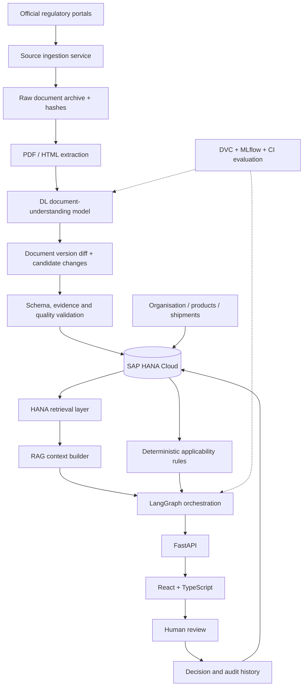
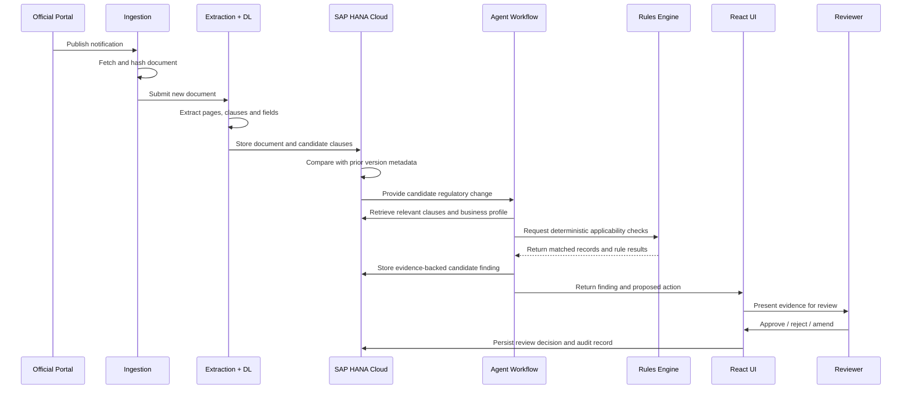
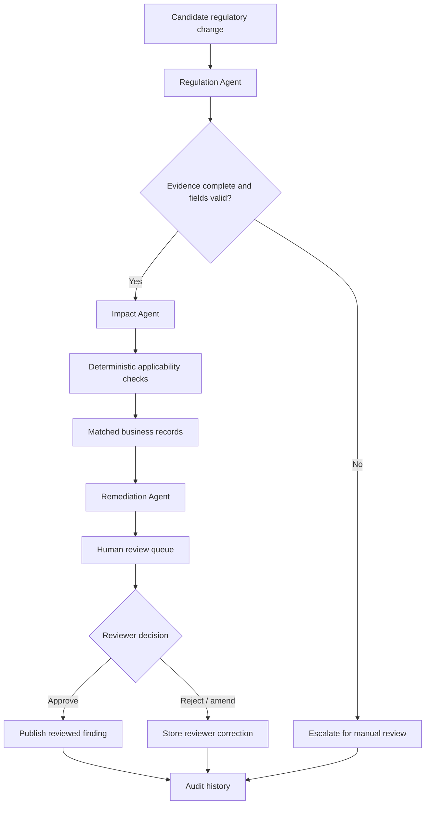
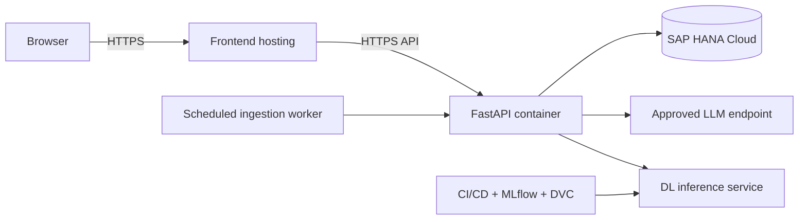

# Compliance Shadow — Technical Architecture

## 1. Architecture objective

Build an evidence-first regulatory intelligence system. Every finding must be traceable to an official source document, a specific version and a clause/page reference.

## 2. Logical architecture

## 3. Service responsibilities

| Service | Responsibility | Key controls |
|---|---|---|
| Source collector | Fetch permitted official publications | Rate limits, source allowlist, retries |
| Document archive | Preserve original document and metadata | Hash, immutable version record |
| Extraction service | Extract text, tables, pages and layout | OCR fallback, extraction quality flags |
| DL service | Extract structured regulatory fields | Versioned model, confidence, evaluation |
| Change detector | Compare current and prior versions | Clause alignment, diff provenance |
| HANA repository | Store regulatory and business data | Tenant isolation, access control |
| Retrieval service | Retrieve clauses relevant to a question/check | Source filters, metadata filters |
| Rules engine | Evaluate explicit applicability conditions | Deterministic tests and rule version |
| Agent orchestrator | Coordinate bounded analysis tasks | Tool allowlist, schema validation |
| API layer | Expose application operations | Authentication, authorization, validation |
| Web client | Present findings and review workflows | No secrets or privileged logic in browser |
| MLOps | Track datasets, models, evaluation and releases | Approval gates and rollback |

## 4. Data flow sequence

## 5. Agent workflow

## 6. HANA logical entities

Use relational tables for transactional integrity and relationships. Consider HANA graph or vector capabilities only if available and justified.

- `ORGANISATION`
- `REGULATORY_SOURCE`
- `REGULATORY_DOCUMENT`
- `DOCUMENT_VERSION`
- `DOCUMENT_CLAUSE`
- `REGULATORY_RULE`
- `BUSINESS_PRODUCT`
- `SHIPMENT`
- `BUSINESS_DOCUMENT`
- `IMPACT_FINDING`
- `REMEDIATION_ACTION`
- `REVIEW_DECISION`
- `MODEL_RUN`

Store a stable identifier for each source and clause. Keep document versions rather than overwriting them.

## 7. Technology boundaries

- React/TypeScript is the presentation layer.
- FastAPI owns application APIs and orchestration entry points.
- SAP HANA Cloud is the primary data platform.
- LangGraph coordinates bounded agent tasks.
- PyTorch/Hugging Face supports the selected document-understanding task.
- MLflow/DVC provide experiment and dataset lineage.
- LLMs produce structured proposals grounded in retrieved clauses; deterministic code validates explicit conditions.

## 8. Deployment view

Deployment topology depends on the available SAP BTP subscription, HANA Cloud tenant, model endpoint and hosting permissions. Confirm these before finalizing infrastructure.
