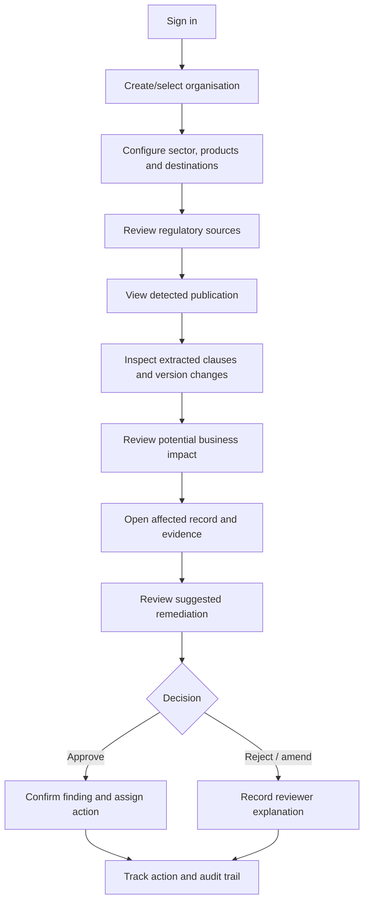

# Compliance Shadow — User Guide

## 1. Purpose

This guide describes the proposed user journey for the Compliance Shadow prototype. Screen names may change during implementation.

## 2. User roles

| Role | Main activities |
|---|---|
| Organisation Admin | Configure organisation profile, users and compliance scope |
| Compliance Reviewer | Review regulatory changes, impact findings and evidence |
| Analyst | Inspect documents, clauses and business records |
| System Admin | Manage source configuration, model releases and system health |

## 3. User journey

## 4. Main screens

### Compliance Overview
Shows new publications, open findings, pending reviews and remediation status.

### Regulatory Updates
Shows issuing authority, publication date, document version, detected change summary and source link.

### Document Detail
Shows the original document reference, page-level extraction, clause text and previous-version comparison.

### Impact Findings
Shows the candidate rule, affected products or shipments, severity, confidence, applicability rationale and evidence.

### Finding Review
Allows an authorized reviewer to approve, reject or amend a candidate finding and add notes.

### Remediation Checklist
Shows proposed steps, owner, due date and progress. The system drafts actions; the responsible person decides whether to execute them.

### Audit History
Shows source versions, model version, evidence references, reviewer decisions and timestamps.

## 5. Interpreting finding fields

| Field | Meaning |
|---|---|
| Severity | Prioritization estimate based on configured impact criteria |
| Confidence | System estimate for the extraction/assessment; not legal certainty |
| Applicability | Why the rule may relate to a business product, activity or record |
| Evidence | Source URL, document version, clause and page reference |
| Status | Candidate, under review, approved, rejected or amended |
| Recommended action | Draft checklist for human consideration |

## 6. Review procedure

1. Open the finding.
2. Confirm the issuing authority and source URL.
3. Open the cited document version and verify the clause/page.
4. Check effective date, applicability conditions and exceptions.
5. Inspect the listed business records.
6. Approve, reject or amend the finding.
7. Add a short reviewer note.
8. Assign follow-up actions only after review.

## 7. Prototype limitations

The prototype should use synthetic business records unless real-data access is authorized. It is not a legal opinion or compliance certificate. Users must verify consequential interpretations with an appropriately qualified professional.
